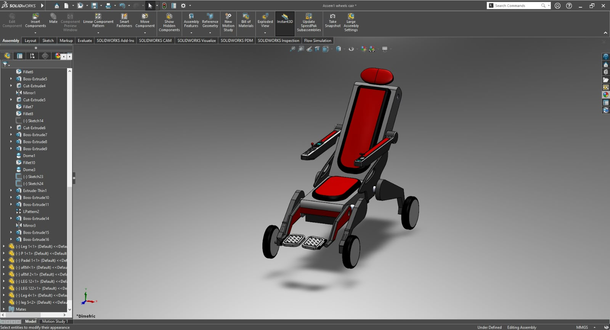
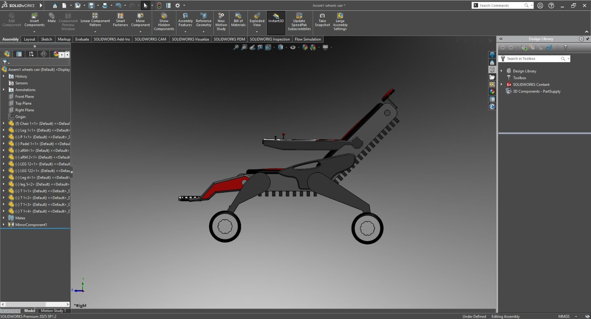
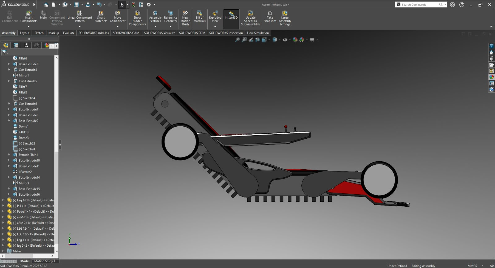
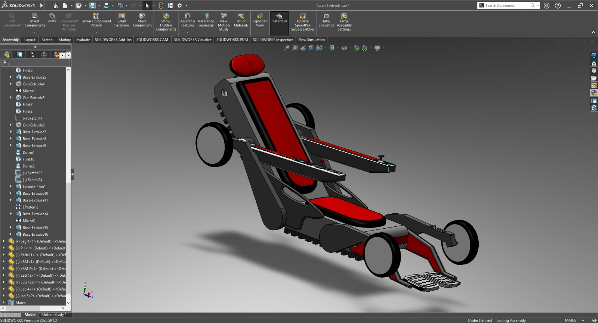

# SAHARA: Smart Autonomous Hybrid Assistive Robotic Architecture

-blue)


**Final Year Project, FAST School of Computing, NUCES Islamabad**
Supervisor: Dr. Suleman Khan | Co-Supervisor: Dr. Muhammad Rizwan

## About the Project

SAHARA is a vision-guided autonomous navigation and adaptive wheel-track mode-switching system for an assistive wheelchair. In developing regions, accessible infrastructure such as ramps and curb cuts is often missing, and commercial stair-climbing robotic wheelchairs (e.g., Scewo BRO, ~$32,000-$47,000) are out of reach for most users.

SAHARA's goal is a low-cost, open-architecture alternative: a high-fidelity **3D digital twin** of a dual-motion (wheel + tank-track) wheelchair, built around the Xsto X12 / CT250S mechanical base, with a simulated ROS 2 intelligence layer for autonomous navigation, terrain perception, and safe mode-switching.

> This repository currently reflects the project up to the **FYP-1 Mid-1 Evaluation (Iteration 1: CAD / mechanical modeling)**.

## Team

| Member | Roll No. | Role in Iteration 1 |
|---|---|---|
| Shahryar Ahmad | 22i-0939 | Component modeling + **full model assembly** |
| Muhammad Awais | 22i-0930 | Component modeling |
| Abdurrehman Ahmed | 22i-0988 | Component modeling |

## Iteration 1: Work Division

Each member independently designed their own set of components in SolidWorks and committed them to this repository. The final integrated assembly was built by Shahryar Ahmad from all contributed parts.

| Contributor | Components Modeled | Files |
|---|---|---|
| **Shahryar Ahmad** (22i-0939) | Arm components, leg components | `aRM.SLDPRT`, `aRM 2.SLDPRT`, `leg 5.SLDPRT`, `LEG 122.SLDPRT` |
| **Shahryar Ahmad** (22i-0939) | Full wheelchair assembly (wheels, track deployment mechanism, mates) | `Assem1 wheels cair.SLDASM` |

Individual contributions can be verified in the [commit history](../../commits/cad_models), where every file was committed by the member who modeled it.

## Iteration 1 Highlights

- Partially articulated SolidWorks assembly of the wheelchair chassis, four-hub wheel drive, and track module
- Revolute mates on wheels (full 360-degree rotation)
- Linear (prismatic-style) mates letting the wheels translate vertically to deploy the track
- Track treads kept static by design, to keep the model clean for the upcoming URDF export
- Early validation with SolidWorks interference detection and kinematic clearance checks

## Renders

### Wheel-drive pose (flat-ground mode)

| Dimetric view | Right side view |
|---|---|
|  |  |

### Track-deployed pose (stair-climbing mode)

| Side view | Isometric view |
|---|---|
|  |  |
## Repository Structure

```
SAHARA/
├── cad_models/        # SolidWorks parts (.SLDPRT) and assembly (.SLDASM)
├── docs/images/       # Renders and screenshots
├── .gitignore
└── README.md
```

## Opening the CAD Model

1. Clone the repo and switch to the `cad_models` branch.
2. Keep **all files together in the same folder** (`cad_models/`). The assembly references the part files and will show missing-reference errors if they are moved apart.
3. Open `Assem1 wheels cair.SLDASM` in SolidWorks.

## Roadmap

| Iteration | Focus | Status |
|---|---|---|
| 1 | SolidWorks geometric modeling and mechanical articulation | Done (Mid-1) |
| 2 | URDF/Xacro export, Gazebo Classic world, inertia tensors | Upcoming (branch `ros2_ws`) |
| 3-5 | Nav2, perception, mode-switch state machine, safety arbitration | FYP-2 |

## Tech Stack

SolidWorks (current) · ROS 2 Humble · Gazebo Classic · Nav2 · Ubuntu 22.04 (planned)

## Acknowledgments

Thanks to our supervisor Dr. Suleman Khan and co-supervisor Dr. Muhammad Rizwan for their guidance.
